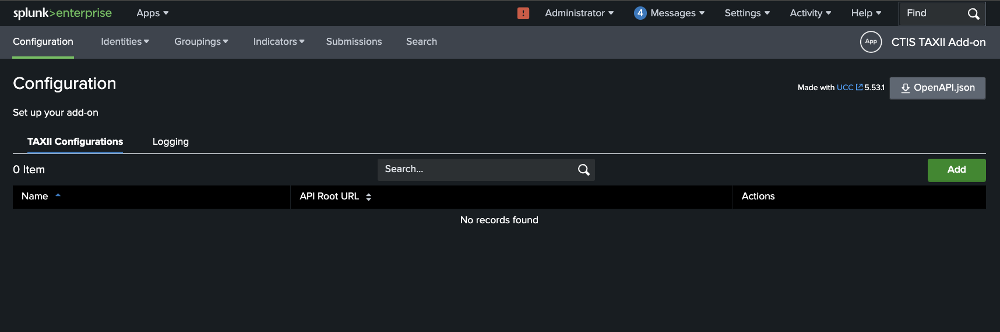
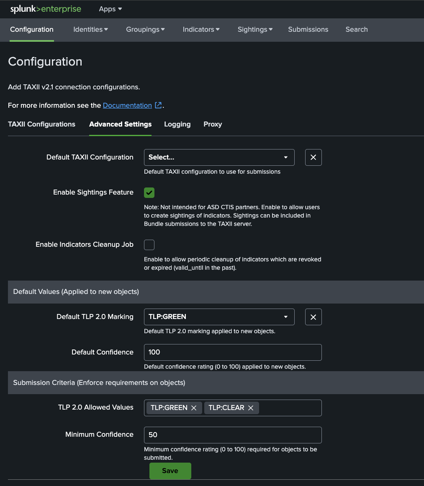

# Configuration

## Network Requirements

The TAXII server must be reachable from the Splunk instance, so please consider:

- Any firewalls which restrict outbound connections from your Splunk environment.
- The TAXII server must accept HTTPS traffic from your Splunk Search Head(s).
- If needed, please contact the ASD CTIS team (or TAXII Server owner) to whitelist your Splunk Search Head(s) IPv4 address(es).

## Setup a TAXII Server Configuration

Start by configuring the TAXII server that will be used to submit STIX bundles.

Navigate to the **Configuration** tab in the app.

Click on the **Add** button to add a new TAXII server configuration.

Fill in the required fields:

- Name: A unique name for the configuration, which becomes the stanza name in the configuration file.
- TAXII API Root URL: The API Root URL for the TAXII Server you would like to use for CTI submissions.
- Authentication Type: The type of authentication required by the TAXII Server. This can be 'Basic' or 'API Key/Bearer Token'

If you select 'Basic' authentication, you will be prompted to enter a username and password.

If you select 'API Key/Bearer Token' authentication, you will be prompted to enter the 'HTTP Header Name' and 'HTTP Header Value' for authentication.

**TAXII Collection Discovery**: This should be enabled, unless your TAXII server credential does not have permission to access the `GET {api_root}/collections` endpoint.

**Default Collection ID**: Is only required if TAXII Collection Discovery is disabled. This should be the default collection ID that you want to submit STIX bundles to.

Clicking on **Add** will verify the connection to the TAXII server including network connectivity and authentication.

Authentication is verified by making a GET request to the TAXII server:

- If 'TAXII Collection Discovery' is enabled, a GET request is made to `{api_root}/collections`.
- Otherwise a GET request is made to `{api_root}/collections/{default_collection_id}`.

## Proxy Server
Proxy server configuration is supported. TAXII server requests can be routed through a `http://` or `https://` proxy URL.
To configure a proxy server, navigate to the 'Proxy' configuration tab.

**Use the 'Enable' checkbox to either enable or disable proxy usage for all TAXII server requests made by the app.**

Username/password authentication is supported.

## Advanced Settings

Advanced settings are all optional. Click **Save** after making changes.

- **Default TAXII Configuration:** You can configure a default TAXII server configuration which is used for submissions. Choose an existing TAXII server configuration from the dropdown.
- **Enable Sightings Feature:** This is an optional feature that allows users to create sightings of indicators. Sightings can be included in Bundle submissions to the TAXII server. Note: Not intended for ASD CTIS partners.
- **Enable Indicators Cleanup Job:** Enables periodic cleanup of indicators that have been marked as 'revoked' or have passed their `valid_until` timestamp.

### Default Values
Available from version `1.39.0`.

The app admin can set a default TLP 2.0 marking and a default confidence rating (0 to 100). These defaults are applied to new objects.

### Submission Criteria
Available from version `1.39.0`.

The app admin can configure validation criteria for objects to be submitted to the TAXII server.
An allowlist of TLP 2.0 values as well as a minimum confidence level can be configured.

Bundles that contain objects that do not meet the criteria will be prevented from being submitted to the TAXII server.

